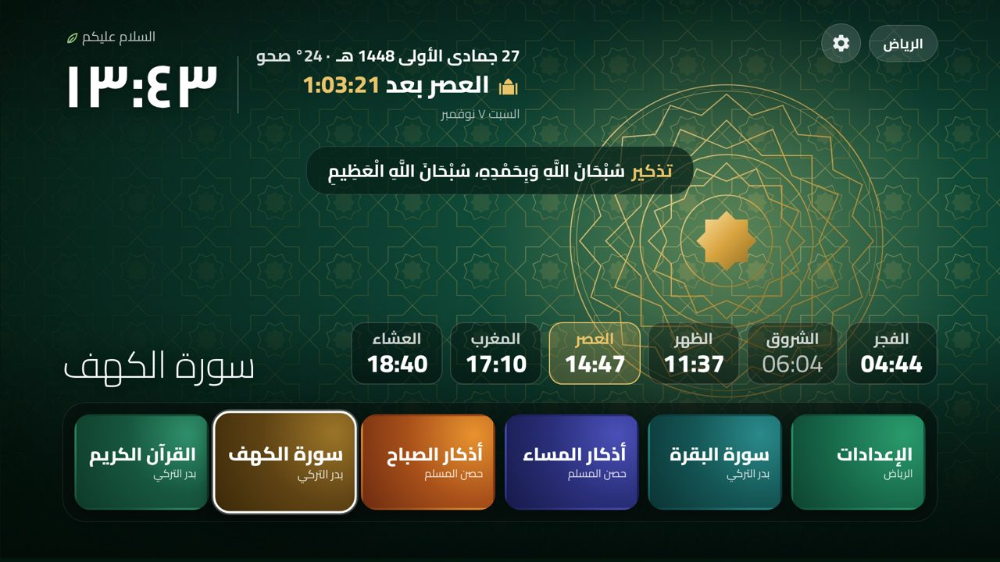
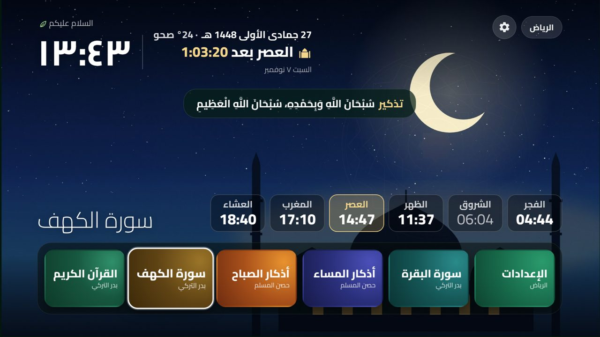
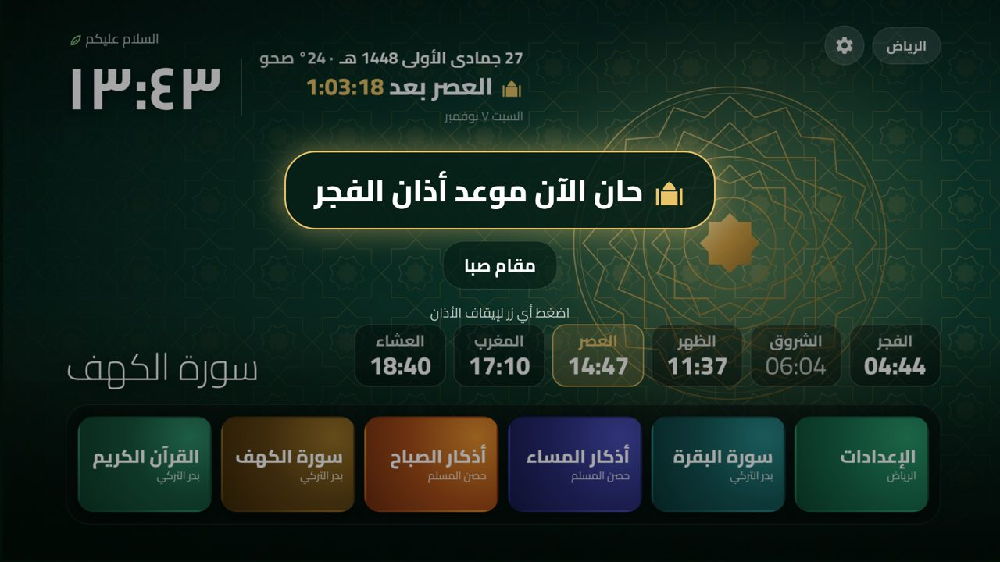
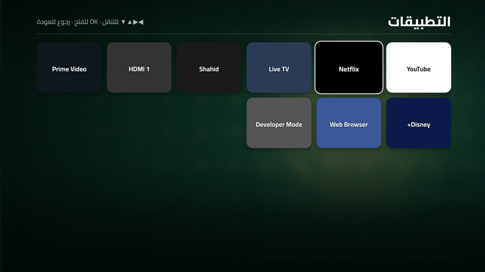
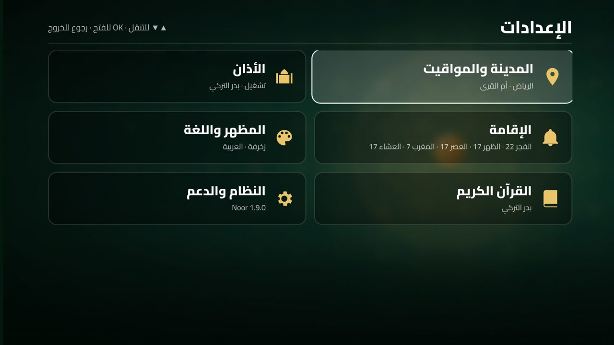
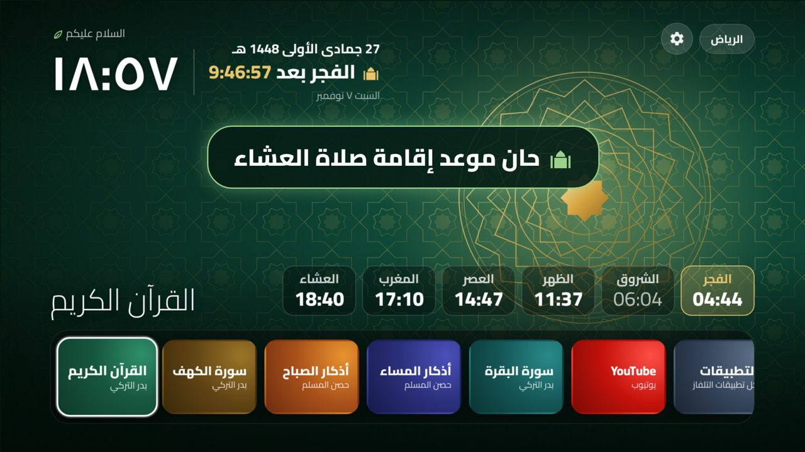

<div align="center">

# نور · Noor for webOS

**Prayer times, adhan, the full Quran and daily adhkar — on any LG webOS TV.**

مواقيت الصلاة والأذان والقرآن الكريم كاملًا والأذكار — على تلفزيونات LG بنظام webOS

[](https://github.com/mhkuhail/noor-webos/releases/tag/v2.0.1)
[](docs/INSTALL.md)
[](https://github.com/mhkuhail/noor-webos/actions/workflows/build.yml)
[](LICENSE)

**⬇️ [Download v2.0.1 (.ipk)](https://github.com/mhkuhail/noor-webos/releases/download/v2.0.1/com.noor.webos_2.0.1_all.ipk)** · [All releases](https://github.com/mhkuhail/noor-webos/releases)

[Install](#install) · [Features](#features) · [What's new](#whats-new-in-200) · [Build from source](#build-from-source) · [Docs](docs/) · [العربية](#بالعربية)

 

</div>

Noor is an open-source TV app inspired by [Noor TV](https://github.com/majedphotos/noor-tv) (Android TV),
rebuilt from scratch for **LG webOS**, which cannot run Android apps. It runs in LG's official
**Developer Mode** — no rooting required.

## Features

| | |
|---|---|
| 🕌 **Prayer times** | Calculated on the TV (works offline) with [adhan-js](https://github.com/batoulapps/adhan-js): 49 cities in 19 countries with their official methods (Umm al-Qura, Diyanet, Dubai, Kuwait, Qatar, MWL, Egyptian, …). Big countdown to the next prayer, Jumu'ah on Fridays. |
| 🔔 **Iqamah** | Countdown after each adhan, then banner + tone + TV notification. Per-prayer intervals (default Fajr 22 · Dhuhr 17 · Asr 17 · Maghrib 7 · Isha 17 min). |
| 📢 **Adhan** | Plays automatically at every prayer — a different recording (and Turkish makam) per prayer: Saba, Uşşak, Rast, Segâh, Hicaz. |
| ⏰ **Always on** | A background service on the TV brings Noor to the front at prayer time, even over YouTube/Netflix, and wakes the screen from *Screen off* / *Night mode*. |
| 📖 **Full Quran** | All 114 surahs recited by **Sheikh Badr Al-Turki** (Hafs), Uthmani text that follows the recitation, continuous play, resume. |
| 🤲 **Adhkar** | Morning & evening adhkar with a tasbih counter; Ayat al-Kursi and the Mu'awwidhat loaded from a verified Quran API. |
| 🔔 **Reminders** | Friday (Al-Kahf, salawat), the White Days, Monday/Thursday fasting, adhkar times. |
| 🎨 **Themes** | Noor TV design: *Zakhrafa*, *Masjid at night*, *Times of day* (changes with Fajr/Asr/Isha). |
| 📺 **Launcher** | YouTube and all TV apps from Noor's dock. |
| 🛠 **Self-maintaining** | Renews Developer Mode automatically; built-in capability check shows what your TV allows. |
| 🌐 **Arabic / English** | RTL-first interface, Hijri + Gregorian dates, weather (Open-Meteo). |

  

## What's new in 2.0.0

- **Adhan & iqamah notifications over YouTube/Netflix now work on webOS 4.x** — the background service is compiled for the TV's Node.js 0.12.
- **49 cities in 19 countries**, each with its official calculation method.
- **Redesigned Settings** with sections: City & prayer times · Adhan · Iqamah · Display & language · Quran · System.


Earlier (1.9.0):
- **Iqamah alerts** — countdown to the iqamah after each adhan, then a banner, a tone and a TV notification (also over YouTube). Defaults: Fajr 22 · Dhuhr 17 · Asr 17 · Maghrib 7 · Isha 17 minutes, adjustable per prayer.



Earlier (1.8.0):
- **The adhan now interrupts YouTube, Netflix and any other app** — a notification one minute before, then Noor comes to the front and plays the adhan. Prayers are also registered with the TV's system scheduler.
- **Adhan service log** in Settings for troubleshooting.

Earlier (1.7.x):
- **Wallpapers fixed on webOS 4.x** — backgrounds now load on the TV's Chromium 53 (they were set through CSS variables, which it ignores).
- **Apps screen never times out** — popular apps show instantly; the TV's real list replaces them when the TV allows it (1.7.1).
- **Screen off → Night mode** — if the TV refuses to turn the screen off, Noor shows a black night screen and the adhan still plays on time (1.7.2).
- **YouTube card and app launcher** (1.7.0) · **background prayer service on the TV** (1.6.0).
- Five adhan recordings bundled, one per prayer.

Full history: [CHANGELOG.md](CHANGELOG.md).

## Install

**Requirements:** LG TV with webOS 4.0 or later (2018+), a free [LG developer account](https://webostv.developer.lge.com/), a computer on the same network.

1. On the TV: install **Developer Mode** from the LG Content Store, sign in, turn on *Dev Mode Status* (the TV restarts), then turn on *Key Server*.
2. On the computer: install [webOS Dev Manager](https://github.com/webosbrew/dev-manager-desktop/releases) and add the TV (IP + passphrase from the Developer Mode app).
3. Download **[com.noor.webos_2.0.0_all.ipk](https://github.com/mhkuhail/noor-webos/releases/download/v2.0.1/com.noor.webos_2.0.1_all.ipk)** (or the newest from [Releases](https://github.com/mhkuhail/noor-webos/releases)) → Dev Manager → **Install**.
4. Open **Noor** on the TV → 🔵 Blue → *TV capability check*.

Full guide with screenshots and macOS notes: **[docs/INSTALL.md](docs/INSTALL.md)**.

### Remote control

| Button | Action |
|---|---|
| ◀ ▶ / OK | Move along the dock / open |
| 🔴 Red · 🟢 Green · 🟡 Yellow · 🔵 Blue | Morning adhkar · Evening adhkar · Al-Kahf · Settings |
| ▲ ▼ | Scroll Quran / adhkar · previous/next surah in the player |
| ◀ ▶ in the player | Seek 15 s |
| Back | Return (on the home screen Noor stays open so the adhan keeps working) |

### Keeping the adhan working

Nothing runs while an LG TV is in standby, so **don't use the power button** at night — use Noor's
**«إطفاء الشاشة» / Screen off** card. Noor turns the screen off (or shows a black *Night mode* if your TV
doesn't allow it), keeps running, and plays the adhan on time. Details and the optional network helper that
can wake a TV from full standby: **[docs/ALWAYS-ON.md](docs/ALWAYS-ON.md)**.

## Build from source

```bash
git clone https://github.com/mhkuhail/noor-webos.git && cd noor-webos
npm install
# adhan recordings are in app/audio/ — replace them to use other muezzins
npm run package            # → dist/com.noor.webos_2.0.0_all.ipk
npm run install-tv         # ares-install to the device named "tv" (ares-setup-device)
```

Requires Node.js 20+. `ffmpeg` is optional (loudness-normalises the adhan files).
Architecture and code tour: **[docs/ARCHITECTURE.md](docs/ARCHITECTURE.md)**.

```
src/        TV app (ES2015 → bundled for Chromium 53)    service/   background JS service (Node 8)
app/        HTML, CSS, icons, wallpapers, chime          helper/    optional Wake-on-LAN helper (Mac / Raspberry Pi)
scripts/    build                                         docs/      documentation and screenshots
```

## Troubleshooting

Wallpapers missing, *apps list timeout*, *screen off not allowed*, Developer Mode expired, Wake-on-LAN —
see **[docs/TROUBLESHOOTING.md](docs/TROUBLESHOOTING.md)**.

## Credits & license

Code: [MIT](LICENSE). Design and wallpapers adapted from [Noor TV](https://github.com/majedphotos/noor-tv) (MIT).
Prayer times: adhan-js · Quran text: [alquran.cloud](https://alquran.cloud) · Recitation: [mp3quran.net](https://mp3quran.net) ·
Weather: [Open-Meteo](https://open-meteo.com) · Fonts: Cairo & Amiri (SIL OFL). Full list: [NOTICE.md](NOTICE.md).

Not affiliated with LG Electronics. *webOS* and *LG* are trademarks of LG Electronics.

---

## بالعربية

**نور** تطبيق مفتوح المصدر لتلفزيونات LG بنظام webOS، مستوحى من مشروع Noor TV لأجهزة Android TV،
ومبني من الصفر لأن webOS لا يشغّل تطبيقات أندرويد. يعمل في «وضع المطوّر» الرسمي من LG دون الحاجة إلى روت.

**المزايا:** مواقيت صلاة محسوبة على التلفاز (أم القرى / ديانت) · أذان تلقائي لكل صلاة بمقام مختلف (صبا، عشاق، راست، سيكاه، حجاز) ·
خدمة خلفية تُظهر نور فوق يوتيوب ونتفليكس وقت الأذان وتوقظ الشاشة · القرآن الكريم كاملًا بصوت الشيخ بدر التركي مع النص العثماني ·
أذكار الصباح والمساء مع عدّاد · تذكير الجمعة والأيام البيض وصيام الاثنين والخميس · ثلاث خلفيات (زخرفة، مسجد الليل، أوقات اليوم) ·
تشغيل يوتيوب وكل تطبيقات التلفاز · تجديد وضع المطوّر تلقائيًا · فحص قدرات التلفاز.

**الإصدار الحالي: 2.0.1** — ⬇️ [تنزيل ملف التطبيق ‎.ipk‎](https://github.com/mhkuhail/noor-webos/releases/download/v2.0.1/com.noor.webos_2.0.1_all.ipk)

**الجديد في 2.0.0:** إصلاح الخدمة الخلفية على webOS 4 فتظهر تنبيهات الأذان والإقامة أثناء يوتيوب · ٤٩ مدينة في ١٩ دولة · إعدادات جديدة بأقسام (المدينة، الأذان، الإقامة، المظهر، القرآن، النظام).

**ومن 1.9.0:** تنبيه الإقامة — عدّ تنازلي بعد الأذان ثم تنبيه وصوت وإشعار على الشاشة حتى أثناء يوتيوب (الفجر ٢٢ • الظهر ١٧ • العصر ١٧ • المغرب ٧ • العشاء ١٧ دقيقة، قابلة للتعديل).

**ومن 1.8.0:** الأذان يعمل الآن أثناء مشاهدة يوتيوب ونتفليكس مع إشعار قبل دقيقة · سجل خدمة الأذان في الإعدادات.

**ومن 1.7.x:** إصلاح ظهور الخلفيات (الزخرفة ومسجد الليل وأوقات اليوم) على تلفزيونات webOS 4 · قائمة التطبيقات تظهر فورًا دون انتظار ·
«وضع الليل» عندما لا يسمح التلفاز بإطفاء الشاشة مع بقاء الأذان في وقته · بطاقة يوتيوب ومشغّل التطبيقات · خدمة الأذان الخلفية · ملفات الأذان الخمسة مضمّنة.

**التثبيت:** فعّل وضع المطوّر على التلفاز ← ثبّت webOS Dev Manager على الكمبيوتر ← نزّل ملف ‎.ipk‎ أعلاه ← Install.
**مهم:** لا تطفئ التلفاز بزر الطاقة ليلًا؛ استخدم بطاقة «إطفاء الشاشة» في نور ليبقى الأذان يعمل.
**ملفات الأذان** موجودة في `app/audio/` — استبدلها بنفس الأسماء لتغيير المؤذن.

الدليل الكامل: [docs/INSTALL.md](docs/INSTALL.md) · حل المشكلات: [docs/TROUBLESHOOTING.md](docs/TROUBLESHOOTING.md)
